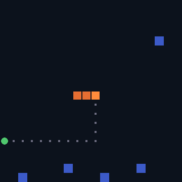
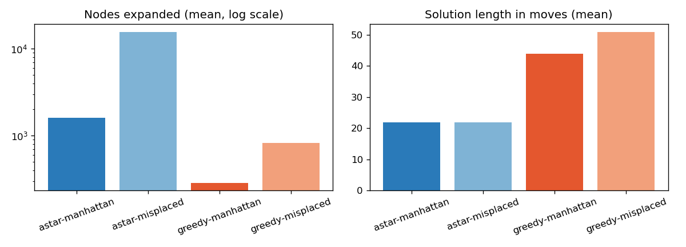

# AI search algorithms: 8-puzzle and Snake

A* and greedy best-first search on two problems from my MS AI course (RIME, NUST, 2023),
rebuilt in Python with tests and measured results.



*The orange snake plans a path to the food with A* (grey dots), treating hurdles (blue) and its own body as walls.*

## 8-puzzle

Ported from my C++ assignment: same goal state (blank top-left, tiles 1–8 in order) and the same two heuristics.

- **Misplaced tiles**: number of tiles out of place.
- **Manhattan distance**: sum of each tile's row and column distance from its goal cell.

Both heuristics are admissible, so A* returns the shortest solution with either. Greedy best-first
orders the frontier by the heuristic alone: it expands fewer nodes but gives up optimality.

Results on 100 random solvable boards (60-move random walks from the goal):

| Method | Mean moves | Optimal | Mean nodes expanded | Median time |
|---|---|---|---|---|
| A* + Manhattan | 21.96 | 100% | 1,618 | 5.9 ms |
| A* + misplaced | 21.96 | 100% | 15,563 | 70.3 ms |
| Greedy + Manhattan | 43.96 | 5% | 287 | 2.3 ms |
| Greedy + misplaced | 50.84 | 2% | 830 | 3.9 ms |



Manhattan is the stronger heuristic (it is never smaller than misplaced), which cuts A*'s work by
about 10x for the same optimal answer.

## Snake

My course project was a tkinter Snake game with an AI opponent that closed the x gap to the food,
then the y gap. That controller is kept here as `greedy`. The new `astar` controller:

1. Runs A* from the head to the food, with hurdles and body cells as walls (the tail cell counts as
   free because it moves away on the next step).
2. If no path exists, follows its own tail to stay alive until one opens.
3. If that fails too, takes any move that is safe right now.

200 games each, 20x20 board, 5 hurdles, 2,000-step limit:

| Controller | Mean food | Median food | Best game | Died before 5 food |
|---|---|---|---|---|
| Greedy (original) | 2.07 | 0 | 14 | 79% |
| A* | 61.26 | 64.5 | 108 | 0% |

The greedy snake mostly dies early by turning back into its own neck or walking into a hurdle.

## Run it

```bash
pip install -r requirements.txt
python -m pytest -q        # 7 tests
python benchmark.py        # rebuilds the tables, plot and GIF in media/
```

```python
from search import puzzle
r = puzzle.solve((1, 2, 5, 3, 4, 0, 6, 7, 8), "astar", "manhattan")
print(r.moves, r.expanded)
```

## Layout

```
search/puzzle.py   8-puzzle state, heuristics, solvability check, A* / greedy search
search/snake.py    headless Snake, greedy and A* controllers
benchmark.py       experiments behind the tables above
tests/             correctness checks (optimality, valid paths, A* beats greedy)
```
